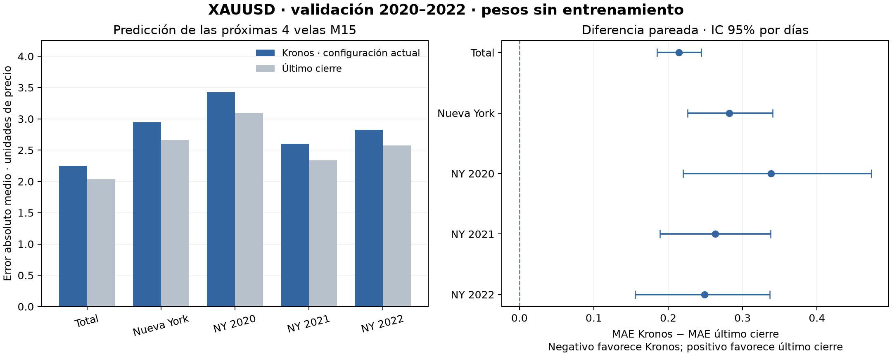

# Evaluación M15 de Kronos: pesos base, 2020–2022

Evaluación terminada sin entrenamiento. RUN_FULL=False; test 2023–2024 no leído.

Se evaluaron 5,065 ventanas con objetivos no solapados, de 18,168 candidatas elegibles. Ventanas NY: 2,179. Contexto: 64 velas (16 horas); horizonte: 4 velas (1 hora).

| Grupo | Ventanas | MAE Kronos | MAE último cierre | Mejora MAE % | IC 95% diferencia MAE |
|---|---:|---:|---:|---:|---:|
| ALL | 5065 | 2.2469 | 2.0327 | -10.54 | [0.1850, 0.2442] |
| NY | 2179 | 2.9437 | 2.6613 | -10.61 | [0.2260, 0.3404] |
| OTHER | 2886 | 1.7208 | 1.5581 | -10.44 | [0.1379, 0.1902] |
| 2020 | 1635 | 2.6686 | 2.4212 | -10.22 | [0.1826, 0.3160] |
| 2020_NY | 698 | 3.4299 | 3.0917 | -10.94 | [0.2199, 0.4730] |
| 2021 | 1716 | 1.8915 | 1.6943 | -11.64 | [0.1614, 0.2343] |
| 2021_NY | 738 | 2.6020 | 2.3387 | -11.26 | [0.1889, 0.3376] |
| 2022 | 1714 | 2.2005 | 2.0010 | -9.98 | [0.1534, 0.2479] |
| 2022_NY | 743 | 2.8264 | 2.5776 | -9.66 | [0.1557, 0.3368] |

MAE en unidades de precio XAUUSD; menor es mejor. Mejora positiva favorece Kronos. Diferencia = error Kronos menos error de mantener el último cierre; un intervalo completamente negativo favorece Kronos.

Resultado global: mejora MAE -10.54%; NY: -10.61%.

## Protocolo y alcance

- Pesos locales de Kronos-small y Kronos-Tokenizer-base, sin cargar checkpoints entrenados. Se conservaron los hashes de archivos y de todos los parámetros antes/después.
- Se evalúa el adaptador causal auditado del proyecto, con generación greedy determinista. No es una reproducción del predictor oficial con muestreo; las conclusiones se limitan a esta configuración.
- Normalización float32 exclusivamente con el contexto, clip ±5, amount=0. Los valores futuros se retiraron de la entrada de inferencia. La verdad y persistencia se puntúan con los valores originales float64.
- Selección cronológica de todas las ventanas elegibles con objetivos separados al menos 60 minutos; sin selección basada en resultados. Los contextos pueden solaparse.
- NY exige que todo el horizonte esté entre 08:30 y 13:00 America/New_York, con DST. El resto incluye horizontes que cruzan los bordes de sesión. Los años corresponden a la fecha de decisión NY.
- IC 95%: 2.000 remuestreos pareados de días NY, conservando todas las ventanas de cada día. Se añade sensibilidad con bloques circulares de 5 días elegibles en summary.csv. Los intervalos no eliminan sesgos de selección ni equivalen a beneficio de trading.
- Cobertura: 756 días con ventanas seleccionadas, 932 fechas NY con al menos una vela. El requisito de 17 horas continuas excluye sesiones con huecos; no representa todas las oportunidades de mercado.
- La exactitud direccional es descriptiva, excluye movimientos reales nulos y cuenta predicciones nulas como fallos. Persistencia predice movimiento cero y se abstiene de dirección. Always-up solo describe el desequilibrio de clases.
- No se midieron spread, comisiones, deslizamiento, órdenes, rentabilidad ni drawdown. Puede existir solapamiento entre el preentrenamiento del modelo y estas fechas históricas.

## Decisión

No queda demostrada una mejora robusta global y NY frente al último cierre. No activar entrenamiento completo por este resultado. El siguiente experimento es contrastar la inferencia oficial y la representación de volumen/amount sobre las mismas ventanas, con protocolo fijo, antes de un piloto SFT limitado. Conservar 2023–2024 reservado.

## Reproducibilidad

config.json fija el experimento antes de predecir; status.json registra verificaciones, entorno y hashes; predictions.parquet contiene cada predicción; window_metrics.csv permite recalcular los intervalos. Los fragmentos en shards permiten reanudar sin repetir inferencias terminadas.

Tiempo de inferencia: 988.5 segundos. Dispositivo: CPU.

## Cobertura de Nueva York

| Año | Días con velas NY | Días evaluados NY | Ventanas NY |
|---|---:|---:|---:|
| 2020 | 259 | 241 | 698 |
| 2021 | 258 | 254 | 738 |
| 2022 | 258 | 256 | 743 |

## Verificación adicional

Las 20.260 predicciones guardadas se contrastaron de nuevo con los tres archivos fuente: precios reales, último cierre y tiempos de cierre coinciden; no hay objetivos temporales duplicados. Los hashes de ambos archivos de pesos coinciden con los publicados en las revisiones oficiales indicadas en provenance_verified.json.

Las métricas auxiliares de magnitud comparan contra movimiento cero, una referencia débil: no demuestran superioridad frente a una estimación histórica de volatilidad o ATR. Las unidades de volumen no se contrastaron con las del preentrenamiento; amount permanece en cero.

## Cobertura de la apertura: limitación decisiva

La auditoría de todas las ventanas candidatas NY, antes de quitar solapamientos, encontró 0 decisiones entre 08:30 y antes de 10:00. La primera hora elegible es 10:00. Por tanto, este experimento no valida la apertura de las 08:30. El contexto estricto de 64 velas continuas, junto con las interrupciones diarias, retrasa la primera decisión elegible. Ejemplo: contexto desde 2020-01-02 18:00:00-05:00 y decisión 2020-01-03 10:00:00-05:00.

La siguiente tarea debe resolver primero esta cobertura: definir por adelantado un contexto más corto que admita la apertura real, conservar las interrupciones explícitas y comparar sobre las mismas ventanas la inferencia oficial y el adaptador auditado. No rellenar precios inventados ni activar entrenamiento completo para compensar esta falta de cobertura.

| Contexto M15 | Horas de contexto | Días con decisión elegible exacta a las 08:30 |
|---|---:|---:|
| 64 velas | 16 | 0 |
| 58 velas | 14.5 | 701 |
| 56 velas | 14 | 724 |
| 48 velas | 12 | 752 |

Este recuento es una comprobación estructural: no se hicieron predicciones con estos contextos alternativos ni se eligió una longitud según sus errores. Un piloto predefinido de 56 velas conservaría 14 horas y habilitaría la apertura en 724 días de la muestra; su capacidad predictiva sigue sin evaluar.
La próxima selección debe anclarse explícitamente a 08:30, 09:30, 10:30 y 11:30 NY para mantener objetivos de una hora sin solapamiento. Reducir el contexto y conservar una selección global iniciada en otra hora no garantiza incluir la apertura.
